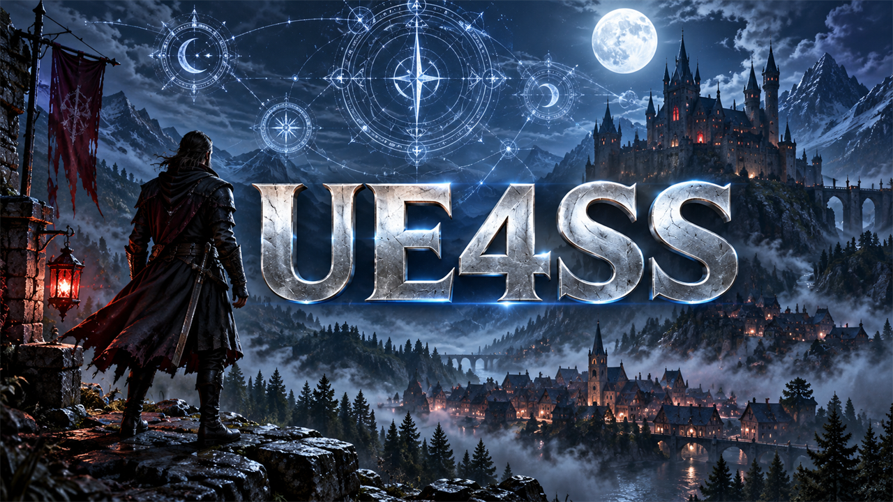

# UE4SS for The Blood of Dawnwalker

The official [RE-UE4SS](https://github.com/UE4SS-RE/RE-UE4SS) script loader, unchanged, with the UE4SS team's config
for The Blood of Dawnwalker: one zip to unpack next to the game.

## What it does

UE4SS (Unreal Engine 4/5 Scripting System) loads Lua and C++ mods into Unreal Engine games while they run. Many
Dawnwalker mods need it. This listing republishes one official UE4SS build, so it can be found on openmods:

- UE4SS `v3.0.1-1181-g83330635`: the official `experimental-latest` build of 2026-10-17 (commit
  [`83330635`](https://github.com/UE4SS-RE/RE-UE4SS/commit/8333063595fa3c49ad307f3b0f732accbb760d25)). The stable
  UE4SS releases (v3.0.1 from 2024) are too old for Unreal Engine 5.5 games such as Dawnwalker.
- The UE4SS team's own config for this game (`TheBloodOfDawnwalker` from `zCustomGameConfigs.zip` of the same build):
  the game's settings and the search pattern UE4SS needs for this game.
- Nothing else: no file is changed, and no mod is added. The official files of the build are attached to the release
  as well, so you can compare.

## Screenshots

## How to install

1. Close the game.
2. Download `dawnwalker_ue4ss_v3.0.1-1181-g83330635.zip` from the latest release on GitHub.
3. Unpack it into the game folder `Dawnwalker\Binaries\Win64\`, next to `Dawnwalker.exe`. You then have
   `Win64\dwmapi.dll` and the folder `Win64\ue4ss\`.
4. Start the game. UE4SS writes its log to `Win64\ue4ss\UE4SS.log`.

To remove UE4SS: close the game, delete `Win64\dwmapi.dll` and the folder `Win64\ue4ss\`.

If you already use another UE4SS package for Dawnwalker, use only one of them: delete the other one's `dwmapi.dll`
and `ue4ss\` folder first, and keep your mods from its `ue4ss\Mods\` folder.

## How to use

UE4SS mods go into `Win64\ue4ss\Mods\<mod name>\`. A mod with an `enabled.txt` file in its folder starts by itself;
other mods are listed in `Win64\ue4ss\Mods\mods.txt`. The build comes with UE4SS's own helper mods: the game console
on `~`, `^` or `F10` (ConsoleEnablerMod), the cheat manager (CheatManagerEnablerMod), a loader for Blueprint mods in
`Dawnwalker\Content\Paks\LogicMods\` (BPModLoaderMod), and keys for dumps (Keybinds).

## Compatibility

- Game version: Patch 2 (`dw1-pc-258504-shipping-patch2-all-CL-258504`, Unreal Engine 5.5.4). Tested on 2026-10-22:
  main menu, save loads, the helper mods, and a Lua mod.
- A game update can need a new UE4SS build or config. Then check the
  [UE4SS releases](https://github.com/UE4SS-RE/RE-UE4SS/releases/tag/experimental-latest) for a newer build.

## Known issues

- The UE4SS log shows that two optional engine functions were not found (`FUObjectHashTables::Get` and
  `ConsoleManagerSingleton`). UE4SS works without them; no problem was seen.
- This is an experimental build of UE4SS. Report problems with UE4SS itself to the
  [UE4SS issues](https://github.com/UE4SS-RE/RE-UE4SS/issues), and problems with this package here.

## How to build

This package builds nothing: it repackages the official build. Building UE4SS from source needs Visual Studio and
access to Epic Games' Unreal source; see the [UE4SS documentation](https://github.com/UE4SS-RE/RE-UE4SS#build-requirements).
`FORK.md` lists exactly what this repository adds to UE4SS.

## Credits

UE4SS is made by the [UE4SS-RE team and its contributors](https://github.com/UE4SS-RE/RE-UE4SS/graphs/contributors),
MIT license. This listing and package: Kintaro. MIT license, as UE4SS. This package is unofficial: the UE4SS team did
not make it and does not support it.
